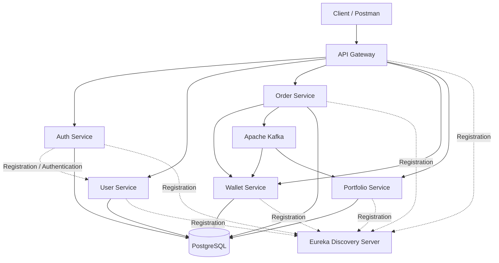
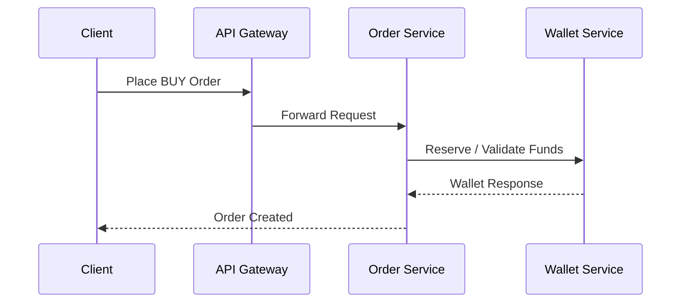
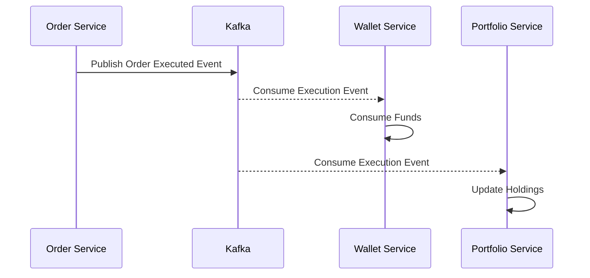

# 🚀 TradeFlux

### Cloud-Native Microservices-Based Trading Platform

**TradeFlux** is a distributed trading platform built with **Java 21, Spring Boot, and Spring Cloud**, designed to simulate the core workflows of a modern stock trading system.

The platform follows a microservices architecture to separate authentication, user management, wallet operations, order processing, and portfolio management. It integrates service discovery, API Gateway routing, asynchronous messaging infrastructure, and containerized deployment to explore how distributed backend systems are designed and operated.

TradeFlux demonstrates an end-to-end trading workflow — from user authentication and wallet funding to order placement, execution, and portfolio tracking.

---

## ✨ Highlights

- 🏗️ **Microservices Architecture** — Independently structured backend services
- 🔐 **JWT Authentication** — Secure authentication and protected API access
- 🌐 **API Gateway** — Centralized request routing
- 🔍 **Service Discovery** — Eureka-based service registration and discovery
- 💰 **Wallet Management** — Fund management and balance tracking
- 📈 **Order Management** — Buy order placement and lifecycle management
- 📊 **Portfolio Tracking** — Holdings and investment tracking
- 📨 **Event-Driven Infrastructure** — Kafka-based messaging infrastructure
- 🐳 **Containerized Deployment** — Docker and Docker Compose
- 🔭 **Observability Infrastructure** — Metrics and distributed tracing components

---

## 🏛️ Architecture

TradeFlux is organized around independently structured microservices that communicate through centralized routing and service discovery.



> The diagram represents the intended service architecture. Verify the current implementation and event consumers before treating every illustrated interaction as an active runtime flow.

---

## 🔄 Core Trading Workflow

TradeFlux simulates the lifecycle of a stock BUY order.

### 1. Order Placement



### 2. Order Execution



The previously tested workflow verified:

- Wallet creation
- Wallet funding
- BUY order placement
- Order execution
- Order status verification
- Wallet balance verification
- Portfolio holding verification

---

## 🧩 Microservices

| Service | Responsibility |
|---|---|
| API Gateway | Centralized entry point and request routing |
| Auth Service | User registration, authentication, and JWT generation |
| User Service | User profile management |
| Wallet Service | Wallet creation, fund management, and balance tracking |
| Order Service | Order placement, lifecycle management, and execution |
| Portfolio Service | Portfolio holdings and position tracking |
| Eureka Server | Service registration and discovery |

---

## 🔌 Communication Patterns

### Synchronous Communication

TradeFlux uses synchronous service communication for operations that require an immediate response.

**Technology:** OpenFeign / REST

Example:

```text
Order Service → Wallet Service
```

### Asynchronous Communication

Apache Kafka provides the messaging infrastructure for event-driven communication.

Events associated with the trading workflow include:

- `UserRegisteredEvent`
- `OrderPlacedEvent`
- `OrderCancelledEvent`
- `OrderExecutedEvent`

The exact event producers, consumers, and processing guarantees depend on the current implementation.

---

## 🔐 Authentication & Security

TradeFlux uses JWT-based authentication.

The authentication workflow:

1. A user registers through the Auth Service.
2. The user authenticates using their credentials.
3. The Auth Service generates an access token.
4. The client sends the token with protected API requests.
5. The API Gateway routes the request to the appropriate service.

Example authorization header:

```http
Authorization: Bearer <ACCESS_TOKEN>
```

---

## 💰 Wallet & Order Management

The wallet and order services support the core trading workflow.

### Wallet Operations

- Wallet creation
- Adding funds
- Balance tracking
- Transaction history
- Fund reservation and consumption

### Order Operations

- BUY order placement
- Order lifecycle management
- Order execution
- Order status tracking

### Portfolio Operations

- Holdings tracking
- Position management
- Average buy price tracking
- Investment amount tracking

---

## 🔭 Observability

TradeFlux includes observability infrastructure for exploring distributed application monitoring.

### Distributed Tracing

**Technologies:**

- Micrometer Tracing
- Brave
- Zipkin

Distributed tracing helps analyze requests across multiple services.

### Metrics

**Technologies:**

- Spring Boot Actuator
- Micrometer
- Prometheus

Metrics can be used to monitor:

- JVM performance
- Memory usage
- HTTP request metrics
- Application health
- Request latency

### Monitoring Dashboard

**Technology:** Grafana

Grafana can be used to visualize metrics collected from the services.

> Confirm that Prometheus scraping and Grafana dashboards are configured and active before describing the monitoring setup as fully operational.

---

## 🐳 Containerization & Deployment

TradeFlux uses Docker and Docker Compose to run the application services and supporting infrastructure.

### Start the Platform

```bash
docker compose up -d
```

### Check Running Containers

```bash
docker ps
```

### Check Service Status

```bash
docker compose ps
```

### View Logs

```bash
docker compose logs <service-name>
```

### Follow Logs

```bash
docker compose logs -f <service-name>
```

### Stop the Platform

```bash
docker compose down
```

---

## 🛠️ Technology Stack

| Category | Technologies |
|---|---|
| Language | Java 21 |
| Backend Framework | Spring Boot 3 |
| Microservices | Spring Cloud |
| API Gateway | Spring Cloud Gateway |
| Service Discovery | Eureka |
| Service Communication | OpenFeign, REST |
| Messaging | Apache Kafka |
| Database | PostgreSQL |
| Authentication | JWT |
| Observability | Micrometer, Spring Actuator, Zipkin |
| Monitoring | Prometheus, Grafana |
| Containerization | Docker, Docker Compose |
| Build Tool | Maven |

---

## 🧪 Verified End-to-End Workflow

The following transaction was previously tested successfully.

### Test Scenario

A user funds a wallet and executes a BUY order for one unit of RELIANCE.

| Operation | Result |
|---|---|
| Wallet funding | 1000 |
| Asset | RELIANCE |
| Order side | BUY |
| Quantity | 1 |
| Price | 100 |
| Order value | 100 |
| Order status | EXECUTED |
| Wallet balance after execution | 900 |
| Reserved balance | 0 |
| Portfolio quantity | 1 |
| Average buy price | 100 |
| Total invested amount | 100 |

### Transaction Flow

```text
User Authentication
        ↓
Create Wallet
        ↓
Add Funds: 1000
        ↓
Place RELIANCE BUY Order
        ↓
Execute Order: 100
        ↓
Verify Order Status
        ↓
Wallet Balance: 900
        ↓
Portfolio Holding: RELIANCE × 1
```

This verifies the basic wallet-to-order-to-portfolio workflow.

---

## 📡 API Testing

The following endpoints were previously used during integration testing.

| Operation | Endpoint |
|---|---|
| Register | `POST /api/v1/auth/register` |
| Current User | `GET /api/v1/users/me` |
| Create Wallet | `POST /api/v1/wallet/create` |
| Add Funds | `POST /api/v1/wallet/add-funds` |
| Place Order | `POST /api/v1/orders` |
| Execute Order | `POST /api/v1/orders/{orderId}/execute` |
| Check Order Status | `GET /api/v1/orders/{orderId}/status` |
| My Portfolio | `GET /api/v1/portfolio/my` |
| Portfolio Summary | `GET /api/v1/portfolio/summary` |

The Auth Service was tested through host port `8086`, and the API Gateway was tested through port `7080`.

---

## 🗺️ Roadmap

- [ ] Kubernetes deployment
- [ ] ConfigMaps and Secrets
- [ ] Ingress Controller
- [ ] Horizontal Pod Autoscaler
- [ ] Minikube deployment
- [ ] AWS EKS deployment
- [ ] CI/CD pipeline with GitHub Actions
- [ ] Centralized logging
- [ ] Enhanced transaction consistency
- [ ] Automated integration testing

---

## 📚 Key Learnings

Through TradeFlux, I explored:

- Designing distributed systems using microservices
- Structuring backend services with Spring Boot
- Implementing JWT-based authentication
- Service discovery and API Gateway routing
- Synchronous and asynchronous communication patterns
- Wallet and order lifecycle management
- Event-driven system design
- Distributed tracing and monitoring
- Docker-based service deployment
- End-to-end integration testing

---

## 👨‍💻 Author

**Tejas Rastogi**

B.Tech Computer Science & Engineering

GitHub: [@TejasRastogi](https://github.com/TejasRastogi)

---

⭐ If you find this project interesting, feel free to explore the repository and its implementation.
